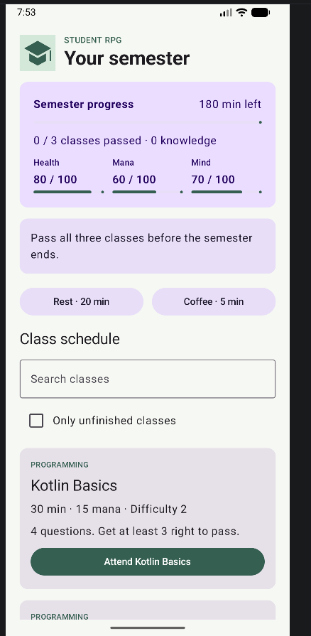
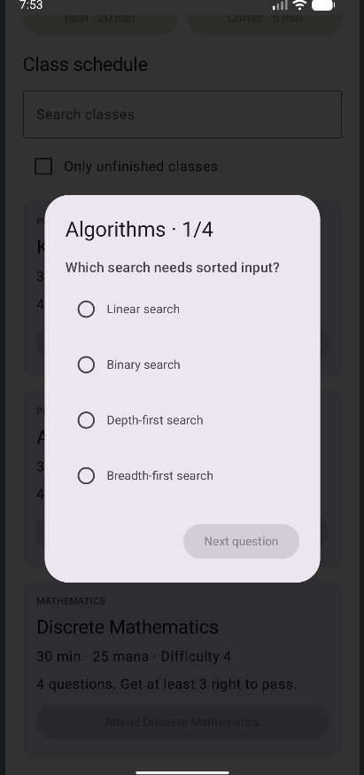

# StudentRPG

A small Android game built with Kotlin, Jetpack Compose, and Material 3. Complete three classes within 180 in-game minutes while managing health, mana, and mental state.

## Features

- Search classes by title or subject and filter out completed classes.
- Attend classes and answer multiple-choice quizzes. Each quiz has four questions; three correct answers are required to pass.
- Track semester progress, knowledge, and character stats.
- Rest to restore health and mental state, or drink coffee to recover mana at the cost of health.
- Start a new semester with a confirmation prompt.
- Keep game progress during screen rotation through a ViewModel, with search, filter, and answer selection restored through Compose state.

## Screenshots

| Semester overview | Class quiz |
| --- | --- |
|  |  |

## Running

### Requirements

- Android Studio with support for the project's Android Gradle plugin.
- JDK 21 (the Gradle daemon configuration uses JetBrains JDK 21).
- Android SDK Platform 36.
- An emulator or Android device running Android 8.0 (API 26) or later.
- Internet access for the initial Gradle sync and dependency downloads.

### Android Studio

1. Open the repository root in Android Studio.
2. Install Android SDK Platform 36 through **SDK Manager** and configure the Gradle JVM to use JDK 21.
3. Allow Gradle sync to finish.
4. Start an emulator or connect a device with USB debugging enabled.
5. Select the **app** run configuration and click **Run**. If needed, create an **Android App** configuration for the **app** module.

### Command line

Configure `JAVA_HOME` to point to your JDK 21 installation and set `sdk.dir` in the untracked `local.properties` file to your Android SDK path. Run these commands from the repository root in PowerShell:

```powershell
.\gradlew.bat :app:assembleDebug
.\gradlew.bat :app:installDebug
```

The install command requires a running emulator or connected device. Open **StudentRPG** on the device after installation. The debug APK is generated at `app/build/outputs/apk/debug/app-debug.apk`.

On macOS or Linux, use `./gradlew` instead of `.\gradlew.bat`.

## Project structure

- `app/` - Android application, Compose interface, and ViewModel.
- `game-core/` - Shared game models and Android-independent game logic.
- `src/main/kotlin/` - Original console game and shared model sources.
- `docs/screenshots/` - Application screenshots.

The original console version is also available:

```powershell
.\gradlew.bat run
```
